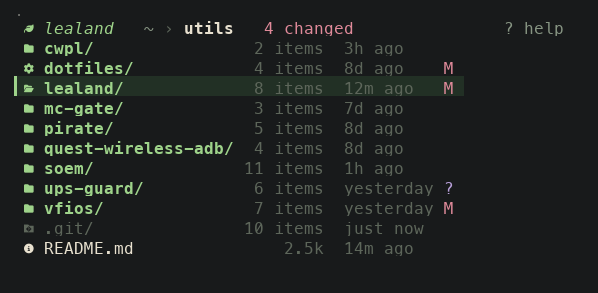

<p align="center">
  <picture>
    <source media="(prefers-color-scheme: dark)" srcset="logo/logo-dark.svg">
    
  </picture>
</p>

lealand is an eza-style listing you can walk around in. You run it as `ll`. It draws under the prompt instead of taking over the terminal, and when you quit, your shell is in the folder you ended up in, with a fresh prompt at the top of the window and everything before it in scrollback.

Typing two letters quickly runs something: `cl` opens Claude Code where you are, `fi` opens Dolphin. Claude Opus 5.5 wrote it.



The listing is only as wide as its longest name. The last column is empty unless something is unusual about the file for the folder it is in: `exec`, `private` (only you can read it), `read-only` in a folder you can write to, `world-writable`, a broken link, or an owner that is neither you nor the folder's owner. The letter before it is git status. Dotfiles are shown, dimmed, after everything else.

## Keys

- **← →** go up a folder, or open the folder or file. Enter also opens. ← stops at `~` unless you started outside it. → on a program or script runs it here and waits for a key after, so you can read what it printed.
- **↑ ↓** move one, **ctrl ↑ ↓** move five. **pgup pgdn home end** do what they say.
- **backspace** goes back to the folder you were in before.
- **/** jumps to any folder. Type part of its name and press tab.
- **:** is a small command line. `cd lealand`, `cd ..` and `cd ~/data` move, and a name that isn't here goes through the `/` jump, so `cd novean` works from anywhere. Tab completes folder names. Anything else, like `claude`, `mkdir x` or `code .`, runs in the shell in this folder and ll comes back after. ↑ ↓ bring back earlier commands.
- **esc esc** quits and leaves the shell where it was.
- **the mouse** works too: click a row to pick it, click it again to open it, scroll with the wheel.

## Chords

Each key of a chord has to come within a second of the last one, and while you're partway through, the bottom line shows what can come next. When a chord is also the start of a longer one, like `mk` and `mkcl`, it waits that second for the next key, or Enter or space runs it straight away.

- **qq** quit and cd to where you are
- **cl** quit, cd, and run `claude`
- **fi** open Dolphin here (ll stays open)
- **code** open VS Code here
- **tt** open a new Ghostty tab here
- **fu** fullscreen, with a preview of the file or folder under the cursor, and back. Code is coloured by bat, pictures are drawn for real in Ghostty (kitty and WezTerm too), and folders show their total size
- **op** open the file with a different app
- **mk** make a folder. Type its name in the top line and press Enter
- **mkcl** make a folder, cd into it and run `claude`
- **rm** move the file or folder to the trash, after a y/n
- **?** the wordmark, this machine (CPU, GPU, memory, monitors, storage) and all the chords and keys

The chords live in `~/.config/lealand/lealand.csv`, one per row, so a spreadsheet can edit them too:

```
keys,action,command
gi,exit,lazygit
cl,exit,claude --continue
ko,spawn,konsole
```

Delete a row to drop a chord. `mkdir` and `mkdir-exit <command>` ask for a folder name, and `trash` asks before moving things to the trash. `spawn` runs a command in the current folder with no terminal, for apps with their own window, and ll stays open. `exit` quits and runs the command in your shell after the cd, so terminal programs go there. A `spawn` command gets the file under the cursor as `$f`.

## Jumping

`/` knows every folder under `~` except hidden ones (`~/.config` is the exception), anything a `.gitignore` covers (the same rules tokei and soem use), and build or cache folders like `node_modules`, `target`, `go/pkg` and Wine prefixes. Typos are fine: `/dwonlods` finds Downloads. The rest of the best match shows greyed out as you type, like zsh-autosuggestions.

Folders you go to often and recently rank higher. That comes from every `cd` in zsh (a hook in the dotfiles zshrc), every folder you open in ll, and on the first run, the `cd`s in `~/.zsh_history`.

With nothing typed yet, the list is the folders you go to most, so `/` then Tab takes you to the top one. You get 2 seconds after `/` and after the first letter, then 500 ms between letters. Running out cancels. Tab or Enter goes, ↑ ↓ picks another match.

## Opening files

The first time you open a type of file, ll lists the apps made for it, with KDE's default on top. Every other app is folded into one row until you open it or start typing. Search matches names, initials (`vsc` is Visual Studio Code) and commands (`code`). Enter opens the file and remembers the app for that MIME type, and Tab opens it just this once. `op` asks again. The app picked before is marked `current`, and Delete forgets it. Terminal apps like micro run in place and ll comes back when they exit.

## Settings

The first run writes `~/.config/lealand/lealand.toml` with every setting and a comment on each: the animations, how tall the view may get, whether dotfiles are dimmed, mixed in or hidden, the chord timing, the folders `/` skips, and the app remembered for each kind of file. Edit it as you like. When ll changes something there itself, it rewrites only that line.

## ll fetch

`ll fetch` prints this machine in a few lines, like fastfetch without the logo: OS, kernel, uptime, desktop, shell, terminal, CPU, GPUs, memory, monitors (by the names in their EDID) and storage. It takes about 7 ms.

## Starting up

It opens with a short animation: a few lines on what it read, then the willow, which dissolves into the listing. It takes about a second, and any key skips it and still does what that key does. Quitting has one too: the listing falls apart into leaves. `ll --disable-flag` turns both off for good and `ll --enable-flag` brings them back. `ll --flag` just shows the wordmark. `lealand` works as a name for `ll` too. It also skips itself in terminals under 82 columns or 26 rows.

## Install

```sh
bash ~/utils/lealand/install.sh
```

It needs cargo, a Nerd Font for the icons, and a terminal with 24-bit colour. The `ll` zsh function does the cd, so it has to be in `~/.zshrc`. The dotfiles zshrc has it, and the installer prints the block if yours doesn't.

## Files

| file | what |
|---|---|
| `~/.config/lealand/lealand.toml` | settings, and the app picked for each MIME type |
| `~/.config/lealand/lealand.csv` | the chords |
| `~/.local/share/lealand/history` | commands typed after `:` |
| `~/.local/share/lealand/visits` | where you've been, for ranking `/` |
| `~/.cache/lealand/dirs` | the folder index, rebuilt in the background when it's over an hour old |

To remove it: `cargo uninstall lealand`, delete those files, and take the block starting `# lealand (~/utils/lealand)` out of the zshrc.

The wordmark is set in [Instrument Serif](https://github.com/Instrument/instrument-serif) Italic (SIL Open Font License) with a willow drawn in code. `logo/make.py` makes both SVGs and the terminal version.
